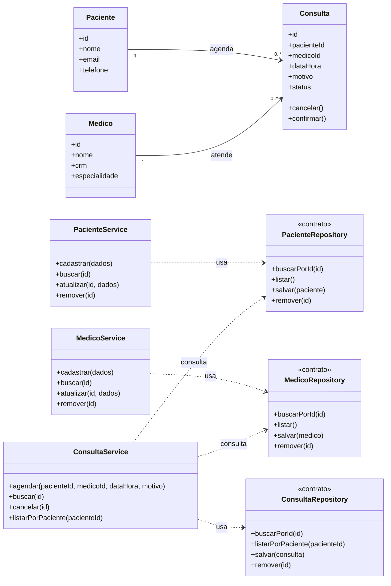

# Modelagem — Projeto 1

**Aluno(a):** Letícia Montenegro  
**Domínio:** Agendamento de consultas em uma clínica

## 1. O domínio

A aplicação organiza os pacientes, os médicos e as consultas de uma clínica. Cada consulta relaciona um paciente a um médico em uma data e horário, com registro de motivo e situação.

## 2. Entidades

| Entidade | Atributos | Relacionamentos |
|---|---|---|
| Paciente | id, nome, email, telefone | pode ter várias consultas agendadas |
| Medico | id, nome, crm, especialidade | pode atender várias consultas |
| Consulta | id, pacienteId, medicoId, dataHora, motivo, status | pertence a um paciente e a um médico |

## 3. Diagrama de classes

## 4. Responsabilidades

| Classe | Papel | Único motivo para mudar |
|---|---|---|
| Paciente | entidade | regras e dados próprios do paciente |
| Medico | entidade | regras e dados próprios do médico |
| Consulta | entidade | regras do ciclo de vida da consulta |
| PacienteService | regra de negócio | processo de cadastro e manutenção de pacientes |
| MedicoService | regra de negócio | processo de cadastro e manutenção de médicos |
| ConsultaService | regra de negócio | regras para agendar, consultar e cancelar consultas |
| PacienteRepository, MedicoRepository, ConsultaRepository | acesso aos dados | forma de persistir e consultar os dados |

## 5. Onde apliquei SRP e DIP

**SRP:** Paciente, Medico e Consulta representam os dados e as regras dos próprios objetos. Os services cuidam dos processos de negócio e os repositories cuidam da persistência; nenhuma entidade salva a si mesma nem acessa o banco.

**DIP:** PacienteService, MedicoService e ConsultaService dependem dos contratos PacienteRepository, MedicoRepository e ConsultaRepository. As implementações concretas poderão mudar sem que os services precisem conhecer o banco ou a tecnologia de armazenamento.

## 6. Fora do escopo (YAGNI)

Login, pagamento, prontuário, envio de lembretes e relatórios ficam fora do Projeto 1. O escopo inicial se limita ao CRUD de pacientes, médicos e consultas.
